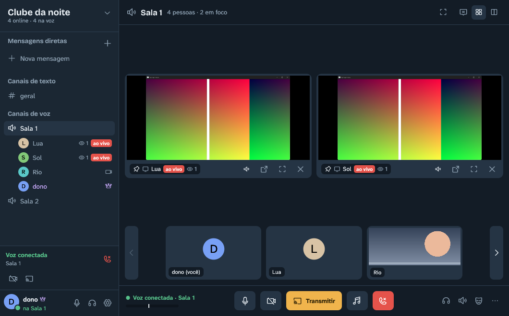
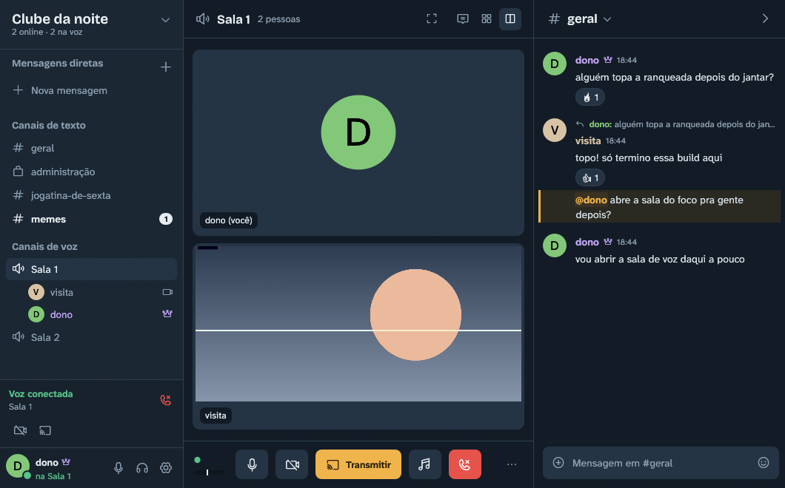
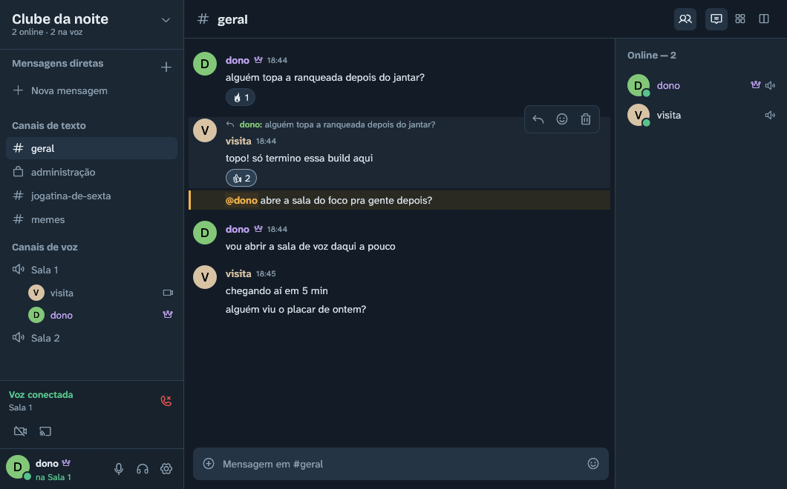
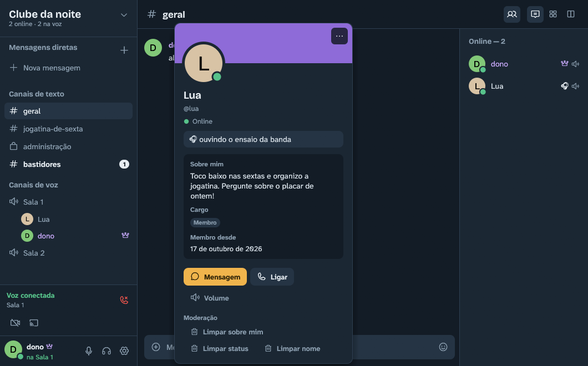

<p align="center">
  
</p>

<h1 align="center">concord</h1>

<p align="center"><b>Voice, screen sharing and chat for your group, hosted on one of your own PCs.</b></p>

<p align="center">English · <a href="README.pt-BR.md">Português</a></p>

concord is a lightweight, self-hosted, Discord-style app for small groups of friends. It has text channels, voice rooms, cameras and Go Live screen sharing. The server runs on someone's PC in the group, like TeamSpeak, so nothing goes through a company in the middle.

The app is called concord. It was called voxhub until v1.0.0. It is a personal project, independent of Discord.

## Preview

| Voice room with two pinned streams | Voice room with a text channel docked |
|---|---|
|  |  |

| Chat with a reply, a mention and reactions | Profile card |
|---|---|
|  |  |

The interface is in Portuguese (pt-BR). People, servers and conversations in the images are fictional.

**Compatibility:** concord has been tested on Windows 11 PCs with NVIDIA graphics, and with friends connecting over the internet. AMD and Intel hardware encoders are detected and self-tested by the app, but they have had little real-world use. If you try other hardware, say so in your issue, with the GPU model and driver version.

### Tested setups

| Setup | Status |
|---|---|
| Windows 11, NVIDIA RTX (NVENC) | Works: voice, cameras, Go Live with app audio, hosting |
| CPU encoding (no hardware encoder, or acceleration turned off) | Works: tested by forcing the CPU encoder on Windows 11 |
| Laptops with two GPUs (AMD/Intel + NVIDIA) | Supported, little real-world testing |
| Windows on ARM, macOS, Linux | Not supported yet |

## Quick start with Claude

If you use Claude Code, clone this repository and tell Claude:

> Set up a concord server for my group.

The [CLAUDE.md](CLAUDE.md) file in the root tells Claude how to download or build concord, host a server, choose between a VPN and opening ports, and invite your friends. Claude will ask you for anything it cannot find, such as your router or VPN.

## Requirements

- Windows 10 (version 2004 or later) or Windows 11, 64-bit.
- A headset is recommended.
- A GPU with hardware H.264 encoding is recommended for cameras and Go Live. Without one, the app encodes on the CPU.
- To host: a PC that stays on while the group is online, plus either a VPN (Tailscale or ZeroTier) or the ability to open ports on your router.

## Download

On the [Releases](../../releases) page:

- **`concord-v1.0.1-PUBLICO.zip`** is the app. Extract the folder (don't run it from inside the zip) and open `concord.exe`.
- **`concord-servidor-v1.0.2.zip`** is the standalone server (optional, see below).

The executables aren't digitally signed. The first time, Windows may show "Windows protected your PC": choose "More info" and then "Run anyway". Download concord only from this repository or from the person who hosts your group.

## Host a server

### From the app (the easy way)

1. On the home screen, choose **"Criar / abrir servidor"** (Create / open server).
2. The first time, the app downloads the voice server (LiveKit, about 19 MB, verified by a pinned SHA-256). It also asks your router (UPnP) to open the ports.
3. When Windows Firewall asks, allow concord on the networks you use. If Windows marks your network as public, tick public networks too; otherwise friends can't connect.
4. Use **"Convidar"** (Invite) to create a code and send it in a private message.

The server stays on while the app is open or in the tray. Whoever creates the server becomes its owner (Dono).

### Standalone server

For a PC that keeps the server running without the app:

1. Download `concord-servidor-v1.0.2.zip` and extract it to a permanent folder.
2. Run `baixar-livekit.bat`. It downloads LiveKit from its official release and checks the hash.
3. Run `liberar-firewall.bat` and accept the Windows prompt. It allows the server and LiveKit through Windows Firewall on all networks, for IPv4 and IPv6 (`remover-firewall.bat` undoes it). It's in the server zip from v1.0.2.
4. Run `iniciar-servidor.bat`. On the first run it creates `data\config.toml`. **Set `server_password`** before you invite anyone, then start it again. From v1.0.2, a few seconds after it starts, the server window shows a connection check (IPv4/IPv6, CGNAT, Windows Firewall) and what to fix.
5. Open `concord.exe` on the same PC and connect to `127.0.0.1` to become the owner.
6. Make the server reachable. From v1.0.2 it listens on IPv6 as well as IPv4, so friends who have IPv6 can usually join through this PC's IPv6 address without port forwarding, even behind CGNAT (invites made on the server include it; some routers block incoming IPv6 until you allow it in their IPv6 firewall settings). Otherwise use a VPN (safer), or forward TCP 7890, 7880, 7881 and UDP 7882 to this PC.

`LEIA-ME-SERVIDOR.txt` inside the zip has the full steps.

## Invite your friends

- **With an invite code:** your friend chooses "Conectar" (Connect), pastes the `vox1-...` code and types a name. No address or password is needed.
- **Without a code:** they enter the server address, a name and the server password, which you send privately.

Invite codes can expire, have a use limit, and be revoked at any time. A code hides the address from casual eyes, but anyone who joins can still learn the host's IP.

## Compatibility and limits

- **No TLS yet:** traffic between the app and the server isn't encrypted, except voice and video. Prefer a VPN to opening ports. See [SECURITY.md](SECURITY.md).
- **Router and ISP:** if your ISP uses CGNAT, your friends can't reach your PC directly. The app detects this and explains the options; a VPN works in that case, and so does IPv6 with the standalone server from v1.0.2.
- **Encoders:** NVENC, AMD and Intel (through Media Foundation) and a CPU fallback. The app tests each one on first start. If viewers report broken video, it switches automatically.
- **Go Live audio:** captures audio from the app you share only (Windows 10 2004+ process loopback). Your voice chat isn't captured.
- **Private channels:** people without access can't read or join them. They can still notice that messages were sent, because message numbers skip.
- **Downgrades:** while any channel is private, older server versions refuse to open the database. Make all channels public before going back to an older version.
- **Group size:** designed for groups of around 15 people.

## Privacy and local storage

concord has no analytics, no accounts on our side and no cloud service. Everything goes between your group's PCs.

The app connects to the internet in these cases only:

- your group's server;
- link previews, which the server fetches so clients never visit arbitrary sites;
- when you host from the app: the LiveKit download from GitHub, a STUN request to `stun.l.google.com` or `stun.cloudflare.com` to learn your public address, and UPnP requests to your router.

Where data is kept:

| What | Where |
|---|---|
| Settings, saved servers, encoder test results | `%APPDATA%\concord\` |
| Servers you host from the app, soundboard cache, logs | `%LOCALAPPDATA%\concord\` |
| Saved passwords and login tokens | Inside those files, encrypted with Windows DPAPI for your Windows user |
| A standalone server's secrets and messages | The server's `data\` folder |

None of these files are part of this repository. Never share a server's `data\` folder.

## Build from source

You need Rust (stable, MSVC) and Visual Studio Build Tools with C++.

```powershell
cargo build --release -p voxhub-app -p voxhub-server
```

The executables are in `target\release\` (`concord.exe` and `concord-server.exe`). The Cargo packages keep their old names, `voxhub-app` and `voxhub-server`.

## Offline checks

These run without anyone else and without touching a real server:

```powershell
cargo test --workspace
powershell -ExecutionPolicy Bypass -File tools\gate.ps1
```

`cargo test` runs the unit and integration tests. `tools\gate.ps1` starts throwaway local servers on loopback (ports 7997, 7990 and 7998, plus LiveKit on 7970–7982) and runs scripted app clients through calls, Go Live, chat, invites and private channels. It needs `bin\livekit-server.exe` (use `hub\scripts\fetch-livekit.ps1`) and a release build. Its windows open in the background and don't take focus.

## Diagnostics

Logs are in `%LOCALAPPDATA%\concord\logs\app` (press Win+R and paste the path). They contain your server's address and people's names, so share them only privately with whoever hosts your group.

## Contributing

Bug reports and pull requests are welcome, in Portuguese or English.

When you report a problem, include:

- your Windows version;
- your GPU model and driver version (for video problems);
- steps to reproduce;
- a redacted error message or log excerpt.

Keep IP addresses, passwords, invite codes, logs and `data\` files out of public issues and pull requests. To report a security problem, see [SECURITY.md](SECURITY.md).

## License

The code is MIT. See [LICENSE](LICENSE). The concord logo is not covered by the MIT license; please don't use it for other projects. Third-party libraries, fonts and icons are listed in [THIRD-PARTY-NOTICES.md](THIRD-PARTY-NOTICES.md).

Made by Cezar Callado · cezar.callado@gmail.com
