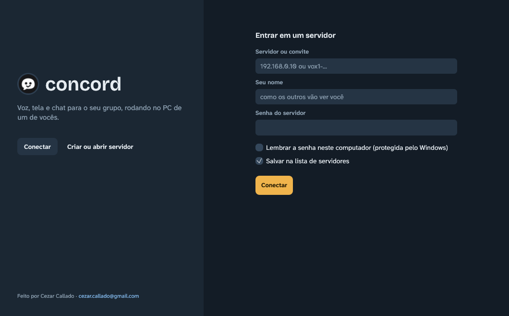

<p align="center">
  
</p>

<h1 align="center">concord</h1>

<p align="center"><b>Voz, tela e chat para o seu grupo, rodando no PC de um de vocês.</b></p>

<p align="center"><a href="README.md">English</a> · Português</p>

O concord é um app leve no estilo do Discord, feito para **grupos de amigos** e **hospedado por vocês mesmos**: canais de texto, salas de voz, câmeras e transmissão de tela (Go Live), com o servidor rodando no PC de alguém do grupo, como no TeamSpeak. Nada passa por uma empresa no meio.

> Até a v1.0.0 o projeto se chamava **voxhub**. Desde a v1.0.1 ele é o concord: o mesmo app, com nome e logo novos. Ele copia sozinho as configurações e os servidores salvos do voxhub, e apps voxhub v1.0.0 e concord conversam normalmente entre si.


## O que tem

| | |
|---|---|
| **Texto** | Canais de texto, mensagens diretas, respostas, menções (`@nome`), reações, imagens (comprimidas antes de enviar), links com prévia e soundboard |
| **Voz** | Salas de voz, supressão de ruído com IA (RNNoise / DeepFilterNet), modificador de voz, push-to-talk e volume por pessoa |
| **Go Live** | Até 4 transmissões ao mesmo tempo, **áudio só do app que você escolheu**, modo "só áudio", fixar várias telas, tela cheia e codificação pela placa de vídeo (NVIDIA, AMD ou Intel) |
| **Câmeras** | Várias câmeras na sala, com ajustes de imagem (brilho, exposição, foco, zoom), espelhar e girar |
| **Mensagens diretas** | Conversa privada entre duas pessoas, com chamada de voz e câmera ("Ligar") |
| **Canais privados** | Só os cargos ou as pessoas escolhidas veem o canal e entram na voz dele |
| **Convites** | Códigos `vox1-...` com validade e limite de usos: o amigo cola o código e entra, sem digitar IP nem senha |
| **Hospedar pelo app** | "Criar servidor" na tela inicial: o app baixa a parte de voz, tenta abrir as portas do roteador e gera os convites |
| **Lista de servidores** | Os servidores em que você já entrou ficam salvos na tela inicial, com uma bolinha verde quando estão ligados |
| **Perfil e moderação** | Foto, "Sobre mim", status e presença; cargos (Dono, Admin, Moderador, Membro), silenciar, mover, desconectar e registro de ações |
| **Bandeja e avisos** | Fechar no X minimiza para a bandeja; contador de não lidas e avisos do Windows |

<p align="center">
  
  
</p>
<p align="center">
  
  
</p>

*(As imagens usam pessoas, servidores e conversas fictícios.)*

## Leve de verdade

App nativo em Rust, sem Electron e sem navegador embutido; o vídeo é codificado pela placa de vídeo. Na medição da v1.0 ([docs/perf-v1.md](docs/perf-v1.md)): parado na tela inicial, **~0% de CPU** e cerca de 80 MB de memória; numa chamada de voz com o chat aberto, **~1% de um núcleo**; assistindo a uma transmissão, cerca de 11% de um núcleo. Os números são do PC de teste e mudam de máquina para máquina.

## Requisitos

- **Windows 10 (versão 2004 ou mais nova) ou Windows 11, 64 bits.**
- Fone de ouvido é recomendado.
- Placa de vídeo com codificação H.264 por hardware é recomendada para o Go Live e a câmera. Sem ela, o app codifica pelo processador.

## Baixar

Na página de [**Releases**](../../releases), baixe o **`concord-v1.0.2-PUBLICO.zip`**, extraia a pasta (não rode de dentro do .zip) e abra o `concord.exe`.

**No Mac** (Apple Silicon, M1 ou mais novo, macOS 13+): baixe o **`concord-1.0.2-mac-arm64.zip`**, arraste o `concord.app` para Aplicativos e siga o `LEIA-ME-MAC.txt` (primeira abertura e permissões). No Mac já funcionam chat, voz, assistir e transmitir (tela, janela, áudio do app e câmera); ainda faltam o ícone na barra de menus, as notificações, o push-to-talk global e hospedar pelo app.

O executável não é assinado digitalmente. Na primeira vez o Windows pode mostrar "O Windows protegeu o computador": clique em "Mais informações" e depois em "Executar assim mesmo". Baixe só deste repositório ou de quem hospeda o seu grupo.

## Como entrar (seus amigos)

- **Com convite:** clique em "Conectar", cole o código `vox1-...` e escreva o seu nome.
- **Sem convite:** informe o endereço do servidor, o seu nome e a senha do servidor (passada em particular).

## Como hospedar

### Pelo app (o jeito fácil)

1. Na tela inicial, clique em **"Criar ou abrir servidor"**.
2. Na primeira vez, o app baixa a parte de voz (o LiveKit, uns 19 MB, conferido por checksum) e pede ao roteador (UPnP) que abra as portas. Quando o Firewall do Windows perguntar, permita nas redes que você usa. Se o Windows marcou a sua rede como pública, marque também redes públicas; senão os amigos não conseguem entrar.
3. Use **"Convidar"** para gerar um código e mande-o em conversa privada.

O servidor fica ligado enquanto o app estiver aberto (ou na bandeja). Quem cria o servidor vira o **Dono**.

### Servidor dedicado (`concord-server.exe`)

Para deixar um PC ligado com o servidor sem abrir o app:

1. Na página de Releases, baixe o **`concord-servidor-v1.0.2.zip`** e extraia a pasta num lugar fixo.
2. Rode `baixar-livekit.bat` (baixa a parte de voz do site oficial e confere o checksum).
3. Rode `liberar-firewall.bat` e aceite o pedido do Windows. Ele libera o servidor e a voz no Firewall do Windows em todas as redes, em IPv4 e IPv6 (o `remover-firewall.bat` desfaz). Vem no zip do servidor a partir da v1.0.2.
4. Rode `iniciar-servidor.bat`. Na primeira vez ele cria `data\config.toml`: **defina uma senha** (`server_password`) antes de convidar alguém. A partir da v1.0.2, alguns segundos depois de ligar, a janela do servidor mostra um diagnóstico de conexão (IPv4/IPv6, CGNAT, Firewall do Windows) e o que corrigir.
5. Deixe o servidor alcançável. A partir da v1.0.2 ele escuta em IPv6 além de IPv4: amigos com IPv6 em geral entram pelo IPv6 deste PC sem abrir portas, mesmo com CGNAT (os convites criados no servidor já levam esse endereço; alguns roteadores bloqueiam IPv6 vindo de fora até você liberar no firewall IPv6 deles). Senão, use uma VPN (mais seguro) ou libere no roteador as portas **TCP 7890, 7880 e 7881** e **UDP 7882**.
6. Abra o app **no próprio PC do servidor** com o endereço `127.0.0.1` para virar o Dono.

O passo a passo completo está no `LEIA-ME-SERVIDOR.txt` dentro do zip.

Detalhes em [hub/README.md](hub/README.md).

## Segurança: leia antes de abrir para a internet

Leia o [SECURITY.md](SECURITY.md). Em resumo:

- O concord foi feito para **grupos pequenos de amigos que confiam entre si**.
- A conexão entre o app e o servidor **ainda não é criptografada** (sem HTTPS/TLS). O áudio e o vídeo vão criptografados; senhas, convites e mensagens, não. **Prefira uma VPN (Tailscale ou ZeroTier)** a abrir portas no roteador.
- Use uma senha de servidor forte e exclusiva, e uma senha pessoal que você não usa em nenhum outro lugar.
- Um código de convite funciona como uma senha: mande só em conversa privada.
- A pasta `data\` (e a de cada servidor criado pelo app) guarda segredos e as mensagens: nunca a envie para ninguém.

## Compilar a partir do código

Requer o Rust (stable, MSVC) e o Visual Studio Build Tools com C++.

```
cargo build --release -p voxhub-app -p voxhub-server
```

Os executáveis ficam em `target/release/` (`concord.exe` e `concord-server.exe`). Os pacotes do Cargo mantêm os nomes antigos (`voxhub-app` e `voxhub-server`).

## Licença

- Código do concord: [MIT](LICENSE).
- **O logo não está sob a licença MIT.** Ele é a marca do projeto; por favor, não o use para representar outros projetos. Veja [THIRD-PARTY-NOTICES.md](THIRD-PARTY-NOTICES.md).
- Bibliotecas, fontes e ícones de terceiros têm as próprias licenças, também listadas em [THIRD-PARTY-NOTICES.md](THIRD-PARTY-NOTICES.md).

## Créditos

Feito por Cezar Callado · cezar.callado@gmail.com

---

**English summary:** concord (called voxhub before v1.0.1) is a lightweight, self-hosted Discord-like app for Windows, written in Rust, for small groups of friends. It has text channels, DMs, replies, mentions and reactions, voice rooms with AI noise suppression, cameras, and Go Live screen sharing with per-app audio and hardware encoding. It also has private channels, invite codes, a saved server list, and one-click hosting from the app (or the standalone `concord-server.exe`). The server runs on one friend's PC. There is no TLS yet, so prefer a VPN and read `SECURITY.md`. Download `concord-v1.0.2-PUBLICO.zip` from Releases. Code: MIT. The logo is not MIT-licensed (see `THIRD-PARTY-NOTICES.md`). Made by Cezar Callado.
